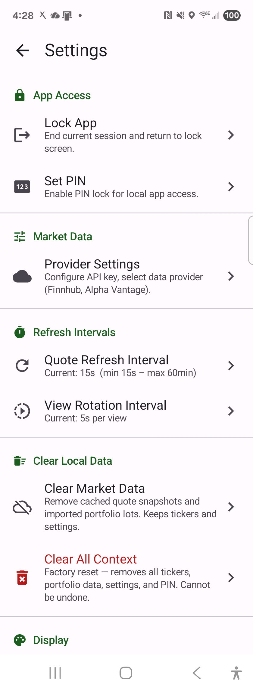
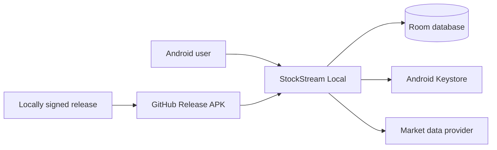

# StockStream Local

[Download StockStream Local 1.0.9](https://github.com/jwgmpi-wolff/devicehoste_stock_streamer/releases/download/v1.0.9/StockStreamLocal-debug.apk)

StockStream Local is a private, device-first Android portfolio and quote tracker. It calls the selected market-data provider directly, stores portfolio data locally, and labels every displayed value as live, delayed, stale, imported, calculated, unavailable, or not provided.



## Features

- Jetpack Compose and Material 3 interface for Android 8.0 and newer.
- Finnhub streaming and Alpha Vantage polling providers.
- Watchlists, holdings, cost basis, gain/loss, sortable quote columns, and rotating views.
- Secure Fidelity browser login/export with local CSV validation and account-aware reconciliation.
- Local PIN and biometric unlock with Android Keystore-backed encrypted preferences.
- Room and DataStore persistence with cloud backup disabled.
- Red negative-change and LIVE badges for immediately visible price direction.
- Local Windows deployment and GitHub Release APK distribution.

## Architecture

The Android application has no backend. Provider credentials, portfolio data, and financial data remain on the device. GitHub Actions builds downloadable APK releases without embedding a provider key.



## Requirements

- Windows 10 or 11
- JDK 17
- Android SDK 35 and Platform-Tools
- Android 8.0+ device or emulator with USB debugging enabled
- A Finnhub or Alpha Vantage API key for live market data

The Gradle wrapper downloads Gradle 8.11.1 automatically.

## Configure

### Choose a market-data provider

StockStream Local supports one provider at a time. The API key is sent directly from the
Android device to that provider and is stored locally using Android Keystore-backed encrypted
preferences.

| Provider | Best choice for | Live-update behavior in this app | Important limits |
| --- | --- | --- | --- |
| [Finnhub](https://finnhub.io/) | US stocks, streaming prices, company profiles, and recent company news | Uses Finnhub's WebSocket trade stream for US-stock last-price updates and REST for complete quote refreshes | Free company news and basic company profiles are available. Daily OHLCV/volume, bid/ask, detailed ETF data, and mutual-fund profiles may require a paid plan. Mutual funds such as `FSELX` may have limited quote/detail coverage. Finnhub permits one WebSocket connection per API key. |
| [Alpha Vantage](https://www.alphavantage.co/) | Polling quotes and broader stock/fund symbol lookup | Polls `GLOBAL_QUOTE`; it does not use a WebSocket | The free service allows up to 25 requests per day. Alpha Vantage states that real-time and 15-minute-delayed US market data require a premium entitlement, so free-plan values should not be treated as streaming exchange data. |

Choose **Finnhub** when immediate US-stock price movement is the priority. Choose
**Alpha Vantage** when tracking funds or using polling is more important. Provider coverage and
entitlements can change, and the app displays unavailable fields rather than inventing values.

### Get a provider key

#### Finnhub

1. Create a personal account on the [Finnhub registration page](https://finnhub.io/register).
2. Open the [Finnhub dashboard](https://finnhub.io/dashboard) and copy the API key shown there.
3. Review the [Finnhub API documentation and current plan limits](https://finnhub.io/docs/api).

Finnhub documents real-time trade streaming for US stocks. Exchange coverage, professional use,
historical volume, mutual-fund details, and other premium datasets depend on the selected Finnhub
plan and its terms.

#### Alpha Vantage

1. Request a key from the [Alpha Vantage API key page](https://www.alphavantage.co/support/#api-key).
2. Select the description that fits your use, provide an email address, and copy the issued key.
3. Review the [Alpha Vantage API documentation](https://www.alphavantage.co/documentation/) and
    [premium real-time data options](https://www.alphavantage.co/premium/).

The free Alpha Vantage key is suitable for light polling and development. A paid entitlement is
required when licensed real-time or 15-minute-delayed US market data is needed.

### Enter the key in the app

1. Open **Settings** from the Home screen.
2. Open **Provider Settings**.
3. Select **Finnhub (Free Real-time)** or **Alpha Vantage**.
4. Paste the matching provider API key into **API Key**, then select **Save**.
5. Return Home and use **Refresh now**. For Finnhub, keep the app in the foreground to receive
    WebSocket price updates.

Do not paste a brokerage password, brokerage token, or a key from a different provider. To switch
providers, repeat these steps with the new provider and its matching key. Use **Clear Provider
Config** to remove the saved provider credentials from the device.

### Save a custom provider API key

In **Settings > Provider Settings**, select **Add custom provider**, enter the **Provider Name**
and **API Key**, then select **Save**. The name and key are stored locally in encrypted preferences.
Reopen Provider Settings to update the name or key; leave the key blank to retain it only when
keeping the same provider name. Switching providers or renaming a custom provider requires a new
key so credentials are not reused for a different service. Only one provider configuration is saved
at a time; saving a different provider replaces it. **Clear Provider Config** removes the saved
name and credentials.

Custom providers currently support credential storage only. Saving a name and key does not
enable quotes or streaming: each provider requires a compatible API integration in the app.
Select a built-in provider to fetch market data.

### Local debug-key option

Create or update the ignored `local.properties` file:

```properties
sdk.dir=C\:\\Users\\YOUR_NAME\\AppData\\Local\\Android\\Sdk
provider.apiKey=YOUR_LOCAL_DEBUG_PROVIDER_KEY
```

The debug build may use `provider.apiKey` as a local default. A key entered in Provider Settings is encrypted and takes precedence. Release and GitHub-built APKs never embed this local key.

The `local.properties` option is intended only for developer-owned debug builds. Never commit API
keys, add them to `README.md`, or include them in screenshots, logs, issue reports, or release APKs.

## Sync Fidelity positions

1. Open **Import** in StockStream and select **Open Fidelity & Export**.
2. Sign in to Fidelity in the system browser and open the **Positions** page.
3. Use Fidelity's **Download** or **Export** control to save the positions CSV.
4. Return to StockStream. The Android file picker opens automatically; select the downloaded CSV.
5. Review the parsed holdings and reconciliation mode, then select **Import Rows** to confirm.

Logging in alone does not transfer holdings. Fidelity must export the CSV because StockStream has
no backend and cannot access browser cookies or brokerage credentials. The CSV is parsed and stored
only on the device. Use **Choose CSV Manually** if the automatic picker is dismissed.

### Import Coinbase transaction history

Use **Import > Choose CSV Manually** to select a Coinbase transaction-history export with
Transaction Type, Asset, and Quantity Transacted columns. Review validation, then confirm.
Import complete history: the app estimates remaining balances and average cost after disposals,
not tax lots. Historical transaction prices are imported baselines, never live quotes.
Reimporting replaces only prior Coinbase transaction-history holdings, including assets whose
balances have reached zero; other broker holdings and manual entries are preserved.

## Build and test

```powershell
.\gradlew.bat :app:assembleDebug
.\gradlew.bat :app:testDebugUnitTest
```

The debug APK is written to `app/build/outputs/apk/debug/app-debug.apk`.

For distributable APKs, explicitly exclude the local debug API key:

```powershell
.\gradlew.bat -PexcludeProviderApiKey=true :app:testDebugUnitTest :app:assembleDebug :app:assembleRelease :app:lintDebug
```

Release APK signing requires the local, ignored `keystore.properties` and keystore.

## Download APK

[Download StockStreamLocal-debug.apk](https://github.com/jwgmpi-wolff/devicehoste_stock_streamer/releases/download/v1.0.9/StockStreamLocal-debug.apk)

[Download StockStreamLocal-release.apk](https://github.com/jwgmpi-wolff/devicehoste_stock_streamer/releases/download/v1.0.9/StockStreamLocal-release.apk)

This is a locally signed development APK for Android 8.0 and newer. It contains no imported portfolio database or market-provider API key. Android may ask you to allow installation from your browser or file manager; configure your provider in the app after installation. GitHub Actions validates builds but does not publish APKs because the private signing key is intentionally excluded from the repository.

## Deploy locally

“Local” deployment means installing the native app on an Android emulator or a USB-connected device from this Windows computer:

```powershell
.\scripts\deploy-local.ps1
```

For multiple devices or a nonstandard Platform-Tools location:

```powershell
.\scripts\deploy-local.ps1 -DeviceId SERIAL -AdbPath C:\path\to\adb.exe
```

The script validates ADB authorization, builds and installs the debug variant, and launches the main activity.
After a successful build, it also copies a versioned APK and `StockStreamLocal-debug.apk` to
`%USERPROFILE%\OneDrive\Apps`. Pass `-ApkArchivePath` to use a different synchronized folder.

## Security

- Do not commit `local.properties`, `keystore.properties`, API keys, or keystores.
- Mobile API keys can be extracted from a sufficiently compromised device; use a restricted, read-only provider key.
- GitHub-built APKs contain no provider key.
- Review provider terms before making direct client-side API calls.

## Regenerate this project with GitHub Copilot

Paste the prompt below into GitHub Copilot Agent mode in an empty workspace. It is intentionally explicit enough to recreate the complete project rather than only a sample screen.

```text
Create a complete, production-quality native Android project named StockStreamLocal. Use Kotlin 2.0.20, Gradle 8.11.1, Android Gradle Plugin 8.5.2, Java 17, compile/target SDK 35, minimum SDK 26, package namespace com.wolffentp.stockstreamlocal, and application ID com.wolffentp.android_stock_tracker. Use Gradle Kotlin DSL and a version catalog. The project must build on Windows with gradlew.bat.

Build the UI entirely with Jetpack Compose using the Compose 2024.08.00 BOM and Material 3. Use Hilt 2.51.1 with KSP for dependency injection, Room 2.6.1 for relational device storage, DataStore Preferences for settings, coroutines and StateFlow for asynchronous state, WorkManager where background scheduling is appropriate, OkHttp 4.12.0 for HTTP and WebSocket transport, and kotlinx.serialization for JSON. Use AndroidX Biometric and Security Crypto for local authentication and encrypted preferences.

Implement a local-only stock and portfolio tracker with no required backend, telemetry, cloud backup, or developer-controlled data collection. Add INTERNET, ACCESS_NETWORK_STATE, USE_BIOMETRIC, and USE_FINGERPRINT permissions. Disable Android backup and data extraction. All tickers, portfolio lots, quote snapshots, settings, layouts, rotating views, and authentication metadata must remain on the device.

Create a clean package structure for auth, columns, csv, data/local, data/model, data/repository, di, market/provider, security, ui/components, ui/navigation, ui/screens, ui/theme, ui/viewmodel, and util. Add a Hilt application class and a single Compose activity.

Implement provider abstractions and concrete Finnhub and Alpha Vantage providers. Finnhub should support WebSocket live updates and REST quote/profile access; Alpha Vantage should support polling and its published free-tier limits. Add connectivity state, refresh state, retry/backoff, rate-limit handling, and provider settings. Never log API keys. Store user-entered keys in Android Keystore-backed EncryptedSharedPreferences. For local debug builds only, read provider.apiKey from ignored local.properties into a BuildConfig DEFAULT_PROVIDER_API_KEY; an encrypted user value takes precedence. Release builds must use an empty default key.

Model quote values with explicit source/quality labels: LIVE, DELAYED, STALE, IMPORTED, CALCULATED, NOT PROVIDED, and UNAVAILABLE. Do not invent missing market values. Render compact badges beside values. When price change is negative, render both the CHG badge and the Symbol column's LIVE badge with the error/red badge color.

Implement screens for local PIN creation/unlock, optional biometric unlock, Home, Watchlist, Add Ticker, Ticker Detail, Fidelity CSV Import, Import Validation, Settings, Provider Settings, Refresh Settings, Column Layout Editor, Rotating Views Editor, Data Quality Legend, and About. Home must include refresh, full-screen, and settings actions; bottom navigation for Home, Watchlist, Import, and Legend; sortable visible columns; holdings editing; online/refresh status; and next/previous rotating-view controls. Create stable, responsive layouts for phones and folding devices.

Implement PBKDF2-SHA256 PIN hashing with a random salt and 200,000 iterations. Store only the derived verifier and metadata in encrypted preferences. Integrate biometric authentication without transmitting biometric state. Disable cloud backup.

Create Room entities, DAOs, repositories, and migrations for tickers, portfolio lots, quote snapshots, column layouts, rotating views, and app settings. Implement computed holdings values such as market value, cost basis, gain/loss, and percentage gain. Keep calculations deterministic and tested.

Implement Fidelity CSV parsing and an import-validation workflow. Parse with a structured CSV approach, normalize symbols and numeric/currency fields, surface row-specific errors, preview accepted/rejected records, and persist only after confirmation. Add unit tests for parser edge cases, repositories, calculations, formatters, provider response mapping, authentication verification, and refresh/rate-limit behavior. Add focused Compose UI tests for navigation and critical screens.

Provide a concise Material 3 theme with accessible contrast, semantic content descriptions, keyboard/screen-reader support, stable control sizes, and no overlapping text. Use standard Material icons. Include a real screenshot under docs/screenshots/stock-stream-local.png and reference it in README.md.

Add scripts/deploy-local.ps1. It must locate adb from PATH or ANDROID_HOME, support optional -DeviceId and -AdbPath parameters, reject missing/ambiguous devices, run :app:installDebug, and launch com.wolffentp.android_stock_tracker.debug/com.wolffentp.stockstreamlocal.MainActivity.

Add a repository-root .github/workflows/release.yml workflow triggered by stockstream-v* tags. Build the debug APK in GitHub without local.properties, publish it to a GitHub Release as StockStreamLocal-debug.apk, and add a README link to https://github.com/jerrywolff_microsoft/devicehoste_stock_streamer/releases/latest/download/StockStreamLocal-debug.apk. The release APK must never contain a provider API key.

Write README.md with architecture, features, screenshot, prerequisites, local.properties example with placeholders only, build/test commands, local deployment, GitHub Release distribution, security notes, and this complete regeneration prompt. Add a .gitignore that excludes local.properties, keystore.properties, keystores, .gradle, .kotlin, build output, and IDE metadata.

Before finishing, run assembleDebug, focused unit tests, and PowerShell syntax validation. Fix defects caused by the generated code. Do not add secrets, generated build directories, or signing material to source control.
```

## License

No license has been declared. All rights are reserved unless the repository owner adds a license.